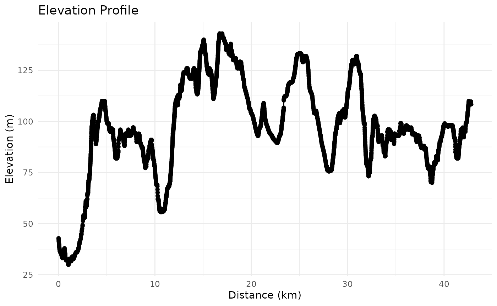
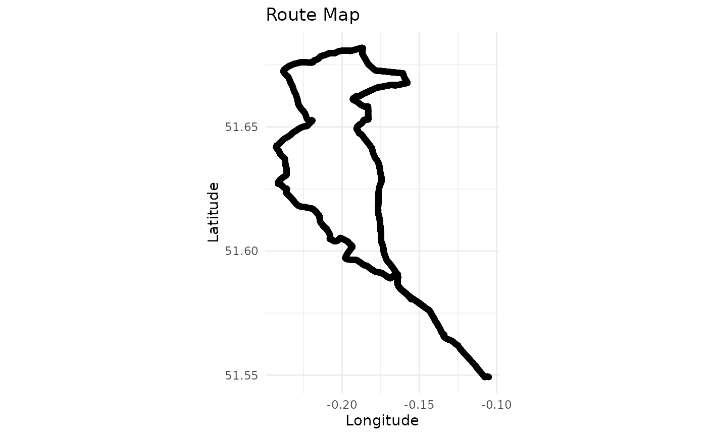

# Introduction to gpxtoolbox

## Overview

`gpxtoolbox` is an R package designed for processing, analysing, and
visualising GPS track data from GPX files. It provides tools for
calculating route metrics such as distance, elevation gain/loss, and
speed, as well as visualisation capabilities for elevation profiles and
route maps.

This vignette demonstrates how to use the key functions of the package.

## Installation

You can install the development version of `gpxtoolbox` from GitHub:

``` r

# Install devtools if not already installed
install.packages("devtools")

# Install gpxtoolbox
devtools::install_github("martinctc/gpxtoolbox")
```

## Example Workflow

The package includes an example GPX file, `icc_intro_ride.gpx`, which is
used in the following examples.

### Load the Package

``` r

library(gpxtoolbox)
```

### Read a GPX File

Use the
[`read_gpx_track()`](https://martinctc.github.io/gpxtoolbox/reference/read_gpx_track.md)
function to extract track points from a GPX file.

``` r

# Path to the example GPX file
example_gpx_path <- system.file("extdata", "icc_intro_ride.gpx", package = "gpxtoolbox")

# Read the GPX file
track_data <- read_gpx_track(example_gpx_path)

# View the first few rows of the track data
head(track_data)
```

    ## # A tibble: 6 × 4
    ##      lon   lat   ele time  
    ##    <dbl> <dbl> <dbl> <dttm>
    ## 1 -0.105  51.5  42.8 NA    
    ## 2 -0.105  51.5  42.7 NA    
    ## 3 -0.105  51.5  42.1 NA    
    ## 4 -0.105  51.5  41.5 NA    
    ## 5 -0.105  51.5  41.4 NA    
    ## 6 -0.106  51.5  40.7 NA

### Calculate Metrics

Use
[`calculate_distance()`](https://martinctc.github.io/gpxtoolbox/reference/calculate_distance.md)
and
[`calculate_elevation_stats()`](https://martinctc.github.io/gpxtoolbox/reference/calculate_elevation_stats.md)
to compute distances and elevation statistics.

``` r

# Calculate distances
track_data <- calculate_distance(track_data)

# Calculate elevation statistics
track_data <- calculate_elevation_stats(track_data)

# View the updated track data
head(track_data)
```

    ## # A tibble: 6 × 10
    ##      lon   lat   ele time   distance cumulative_distance ele_gain
    ##    <dbl> <dbl> <dbl> <dttm>    <dbl>               <dbl>    <dbl>
    ## 1 -0.105  51.5  42.8 NA         0                0              0
    ## 2 -0.105  51.5  42.7 NA         2.36             0.00236        0
    ## 3 -0.105  51.5  42.1 NA         9.42             0.0118         0
    ## 4 -0.105  51.5  41.5 NA        11.2              0.0230         0
    ## 5 -0.105  51.5  41.4 NA         2.08             0.0250         0
    ## 6 -0.106  51.5  40.7 NA        12.3              0.0374         0
    ## # ℹ 3 more variables: ele_loss <dbl>, cumulative_ele_gain <dbl>,
    ## #   cumulative_ele_loss <dbl>

### Generate Route Statistics

Use
[`calculate_route_stats()`](https://martinctc.github.io/gpxtoolbox/reference/calculate_route_stats.md)
to summarise route statistics such as total distance, elevation gain,
and average speed.

``` r

# Calculate route statistics
stats <- calculate_route_stats(track_data)

# Print the statistics
print(stats)
```

    ## $total_distance_km
    ## [1] 42.81
    ## 
    ## $total_elevation_gain_m
    ## [1] 621.9
    ## 
    ## $total_elevation_loss_m
    ## [1] 556.3
    ## 
    ## $max_elevation_m
    ## [1] 143
    ## 
    ## $min_elevation_m
    ## [1] 29.9

### Visualise the Route

Use
[`plot_route()`](https://martinctc.github.io/gpxtoolbox/reference/plot_route.md)
to create visualisations of the route, including an elevation profile
and a route map.

``` r

# Plot the route
plot_route(track_data)
```



### Analyse a GPX File in One Step

The
[`analyse_gpx()`](https://martinctc.github.io/gpxtoolbox/reference/analyse_gpx.md)
function provides a high-level interface to process a GPX file and
return statistics, plots, or processed data.

``` r

# Analyse the example GPX file and get summary statistics
stats <- analyse_gpx(example_gpx_path, return = "stats")
```

    ## Reading GPX file: /home/runner/work/_temp/Library/gpxtoolbox/extdata/icc_intro_ride.gpx

``` r

print(stats)
```

    ## $total_distance_km
    ## [1] 42.81
    ## 
    ## $total_elevation_gain_m
    ## [1] 621.9
    ## 
    ## $total_elevation_loss_m
    ## [1] 556.3
    ## 
    ## $max_elevation_m
    ## [1] 143
    ## 
    ## $min_elevation_m
    ## [1] 29.9
    ## 
    ## $start_point
    ## [1] "43, Fieldway Crescent, Highbury, London Borough of Islington, Greater London, England, N5 1PU, United Kingdom"
    ## 
    ## $end_point
    ## [1] "Highgate Shoe Care, 367, Archway Road, Muswell Hill, London Borough of Haringey, Greater London, England, N6 5FJ, United Kingdom"
    ## 
    ## $p25_point
    ## [1] "Highwood Hill, Mill Hill, London Borough of Barnet, Greater London, England, NW7 4HN, United Kingdom"
    ## 
    ## $p50_point
    ## [1] "36, Camlet Way, Hadley Wood, London Borough of Enfield, Greater London, England, EN4 0LJ, United Kingdom"
    ## 
    ## $p75_point
    ## [1] "Lincoln Road, Colney Hatch, London Borough of Barnet, Greater London, England, N2 9EL, United Kingdom"

``` r

# Generate a plot of the route
analyse_gpx(example_gpx_path, return = "plot")
```

    ## Reading GPX file: /home/runner/work/_temp/Library/gpxtoolbox/extdata/icc_intro_ride.gpx


``` r

# Get processed track points data
track_data <- analyse_gpx(example_gpx_path, return = "data")
```

    ## Reading GPX file: /home/runner/work/_temp/Library/gpxtoolbox/extdata/icc_intro_ride.gpx

## Working with Web Links

You can also analyse GPX files from web links (e.g., Strava or
RideWithGPS). The function will automatically download the GPX file and
process it.

``` r

# Analyse a GPX file from a Strava link
# stats <- analyse_gpx("https://www.strava.com/routes/3193200014155699162")

# Analyse a GPX file from a RideWithGPS link
# stats <- analyse_gpx("https://ridewithgps.com/routes/39294504")
```

## Conclusion

`gpxtoolbox` provides a comprehensive set of tools for working with GPX
files in R. Whether you’re an outdoor enthusiast, athlete, or
researcher, this package makes it easy to process, analyse, and
visualise GPS track data.
